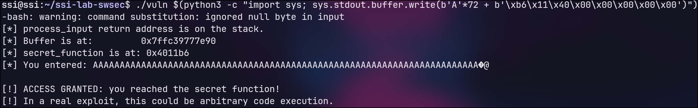

## Parte A

### Exercício 1
* fno-stack-protector: Desativa o stack canary, permitindo que um buffer overflow sobrescreva o endereço de retorno.
* z execstack: Permite a execução de código na stack, essencial para rodar shellcode.
* no-pie: Desativa o PIE, mantendo os endereços de memória fixos para facilitar o cálculo de saltos.
* g: Inclui símbolos de debug para análise detalhada do código e variáveis no GDB.

### Exercício 2
1. 0x7fffffffe240
2. 0x7fffffffe288
3. 72 Bytes
4. 0x4011b6

### Exercício 3
Offset: 72 bytes (64 do buffer + 8 do saved RBP).

Endereço usado: 0x4011b6 (representado em little-endian como \xb6\x11\x40\x00\x00\x00\x00\x00).

Comando completo: ./vuln $(python3 -c "import sys; sys.stdout.buffer.write(b'A'*72 + b'\xb6\x11\x40\x00\x00\x00\x00\x00')")

### Exercício 4: Efeito das Mitigações

| Flags de Compilação | Mitigação Ativa | Exploit Funciona? | Mensagem / Erro |
| :--- | :--- | :--- | :--- |
| -z execstack -no-pie -g | Stack Canary | Não | *** stack smashing detected *** |
| -fno-stack-protector -z execstack -g | PIE / ASLR | Não | Segmentation fault (core dumped) |
| -g | Todas | Não | *** stack smashing detected *** |

* **Stack Canary**: O compilador insere um valor secreto antes do endereço de retorno. O overflow corrompe este valor, fazendo o programa abortar antes de desviar a execução.

* **PIE / ASLR**: Randomiza os endereços de memória a cada execução. O endereço fixo da secret_function usado no exploit torna-se inválido.

* **Todas (NX Incluído)**: Além das anteriores, o NX (No-Execute) impede a execução de código na stack, bloqueando a execução de shellcode mesmo que o endereço de retorno fosse controlado.

### Exercício 5

1. Substituição do strcpy por funções que validam o tamanho do buffer (64 bytes), impedindo que o input sofra de overflow para o endereço de retorno.

2. Compilação sem flags de desativação (gcc vuln.c), mantendo Stack Canary, PIE e NX ativos.

## Parte B

### Exercício 6

1. Aviso: warning: format not a string literal and no format arguments [-Wformat-security]. Alerta que a string de formato não é constante, avisando para o risco de injeção de format strings pelo utilizador.
2. É útil por alertar para padrões perigosos conhecidos diretamente na compilação. É insuficiente porque depende da ativação de flags específicas, pode gerar falsos positivos/negativos em funções complexas ou indiretas, e não avalia o comportamento real do programa em execução.

### Exercício 7

1. Em vez da string literal, imprime vários valores em hexadecimal (ex: 0x7ffe..., (nil)). Revela o conteúdo da memória da stack e registos, ao contrário da execução normal.
2. A função printf não verifica quantos argumentos foram efetivamente passados, apenas consome cegamente valores dos registos e da stack para cada especificador (como %p) que encontra na string.
3. O %x lê valores de 32 bits, enquanto o %p lê ponteiros completos formatados. O apropriado para 64 bits é o %p, pois lê blocos completos de 64 bits adequados ao tamanho da palavra (word).

### Exercício 8

1. Gerado com comando do enunciado
2. O valor impresso é 0xcafebabe. No ambiente testado, este valor aparece exatamente na 8ª posição da sequência. Isto ocorre porque os primeiros 5 especificadores %p esgotam os registos da arquitetura x86-64 usados para passagem de argumentos, forçando o printf a ler os valores seguintes (do 6º em diante) diretamente da stack, onde a variável local secret está armazenada.
3. Fuga de Informação. O atacante consegue recuperar dados arbitrários residentes na stack do processo, podendo extrair variáveis locais sensíveis, endereços de memória ou stack canaries.

### Exercício 9
1. Linha corrigida: printf("%s", input). O input do utilizador passa a ser tratado estritamente como dados (texto) do argumento %s. Especificadores inseridos pelo utilizador (como %p) não são interpretados pelo printf.
2. Ao introduzir "%p %p", o programa imprime literalmente %p %p. A stack já não é lida nem exposta.
3. O comando `gcc -o fmtvuln_secure fmtvuln_secure.c -g -Wall -Wformat -Wformat-security` já não gera qualquer aviso de segurança.