# Relatório Técnico

**Projeto de Segurança de Sistemas Informáticos (2025/2026)**  
**Sistema de Chat Seguro com E2EE**

---

## 1. Introdução

Este documento descreve o contributo da infraestrutura central do sistema: serviço de comunicação, gestão de sessões, entrega diferida de mensagens e suporte de confiança por certificados digitais.

O objetivo principal passa por garantir disponibilidade e integridade operacional sem quebrar o princípio de cifragem fim-a-fim. O servidor coordena ligações e entrega mensagens, mas não acede ao conteúdo em texto legível.

### 1.1 Visão geral E2EE

O sistema segue uma arquitetura cliente-servidor com cifragem fim-a-fim (E2EE):

1. O servidor fornece disponibilidade (encaminhamento, armazenamento temporário, distribuição de bundles públicos).
2. Os clientes executam toda a criptografia sensível localmente.
3. O servidor nunca deve ter acesso a plaintext de mensagens nem a chaves privadas dos utilizadores.

Nesta fase foi implementado o núcleo criptográfico e a camada de protocolo base:

- Primitivas: AES-256-GCM, HKDF-SHA256, HMAC-SHA256, Ed25519, X25519.
- Estabelecimento de sessão: X3DH.
- Evolução de sessão: Double Ratchet.
- Transporte: framing TCP com cifra AEAD por mensagem e serialização JSON canónica.

### 1.2 Componentes

- crypto/
	- primitives.py: cifragem simétrica autenticada (AES-256-GCM).
	- kdf.py: derivação de chaves (HKDF e KDFs do ratchet).
	- asymmetric.py: assinaturas Ed25519, DH X25519 e serialização de chaves.
	- x3dh.py: protocolo de estabelecimento inicial de segredo partilhado.
	- ratchet.py: Double Ratchet para forward secrecy e tolerância a mensagens fora de ordem.

- protocol/
	- messages.py: tipos de mensagem, serialização, assinatura e verificação canónica.
	- transport.py: envio/receção com framing length-prefixed e envelope AES-GCM.
	- handshake.py: handshake de transporte com X25519 efémero e derivação HKDF de chaves direcionais.

- client/
	- client.py: gestão de ligação ao servidor, handshake, autenticação, receive loop assíncrono, listener P2P e política de entrega server-first com fallback direto.
	- cli.py: interpretador de comandos, UX de terminal e orquestração de managers (keys/sessions/contacts/groups).
	- session_manager.py: gestão local de sessões 1:1 (X3DH + Double Ratchet) e persistência de estado.
	- group_manager.py: cifragem de grupos por Sender Keys, com evolução de chain key por mensagem.

- storage/ e server/
	- Camadas operacionais já integradas no sistema; detalhes de implementação do servidor, PKI e persistência ficam documentados nas secções atribuídas a esses componentes.

### 1.3 Fluxos de Comunicação

- Handshake de transporte
	- Cliente e servidor trocam chaves efémeras X25519.
	- Ambos derivam material comum e extraem duas chaves de 32 bytes via HKDF: uma de envio e outra de receção.

- Estabelecimento de sessão (X3DH)
	- O iniciador valida a assinatura do Signed PreKey do destinatário.
	- São calculados 3 ou 4 outputs DH (dependendo de One-Time PreKey).
	- O segredo de sessão é derivado por HKDF com contexto dedicado (info = X3DH).

- Envio/receção de mensagens
	- O remetente cifra cada mensagem com message key única derivada pelo Double Ratchet.
	- O destinatário avança o seu estado de ratchet, incluindo suporte a mensagens fora de ordem até um limite configurado.

### 1.4 Gestão de Chaves

- Identity Keys
	- Ed25519: identidade de assinatura de longo prazo.
	- X25519: identidade DH de longo prazo.

- Signed PreKey (X25519)
	- Chave intermédia publicada e assinada pela identidade Ed25519.
	- Protege contra substituição de chave pública no arranque de sessão.

- One-Time PreKey (X25519)
	- Chave opcional consumida numa única sessão para maior entropia e proteção adicional.

- Session Key (X3DH)
	- Chave de 32 bytes derivada dos outputs DH concatenados.

- Root/Chain/Message Keys (Double Ratchet)
	- root_key: evolui com DH ratchet.
	- chain_key_send/recv: evoluem por mensagem.
	- message_key: efémera, usada uma vez e descartada.

### 1.5 Arquitetura do Cliente (client.py e cli.py)

#### 1.5.1 Núcleo de transporte e entrega (`client.py`)

O `ChatClient` encapsula a lógica de transporte e coordenação de entrega:

1. `connect()` estabelece TCP e executa handshake efémero X25519, derivando chaves direcionais de transporte.
2. `register()` e `login()` tratam autenticação e atualização de endpoint P2P anunciado ao servidor.
3. `fetch_bundle()` e `fetch_offline_messages()` executam operações request-response; `send_chat_message()` faz envio one-way para encaminhamento.
4. `start_receiving()` inicia um receive loop assíncrono dedicado; `pause/resume` evita corridas entre leitura contínua e operações síncronas (ex.: `fetch_bundle`).
5. `ensure_direct_listener()` expõe listener P2P local; `send_chat_message_routed()` aplica política server-first com fallback direto quando o envio via servidor falha.

Esta arquitetura separa explicitamente plano de controlo (auth, bundles, offline) do plano de dados (payload E2EE), mantendo o cliente como ponto de decisão de roteamento.

#### 1.5.2 Interface de comandos e orquestração (`cli.py`)

O `ChatCLI` funciona como camada de apresentação e orquestração:

- Faz parsing e despacho de comandos (`_process_command`).
- Inicializa componentes locais após autenticação (`KeyManager`, `SessionManager`, `ContactManager`, `GroupManager`, `ClientDB`).
- Processa mensagens recebidas, incluindo deduplicação por `msg_id` e distinção entre mensagens 1:1 e mensagens de grupo.
- Mantém fluxo interativo robusto (erros de uso, comandos inválidos, e feedback contextual ao utilizador).
- Inclui separadores visuais por comando (`Output · /<comando>`) e secções assíncronas (`LIVE`/`OFFLINE`) para separar claramente output de sistema e mensagens.
- Implementa auto-complete com `TAB` para comandos de raiz e subcomandos de `/group`, melhorando navegação na interface.

#### 1.5.3 Gestão local de sessões (`session_manager.py`)

`SessionManager` mantém uma sessão por par remoto:

1. **Bootstrap**: em `initiate_session()`, constrói `KeyBundle`, valida SPK via X3DH e inicializa estado de Double Ratchet como emissor.
2. **Receção inicial**: em `receive_initial_message()`, reconstrói segredo de sessão (lado recetor), consome OPK quando aplicável e inicializa ratchet.
3. **Operação contínua**: `encrypt_message()` e `decrypt_message()` encapsulam evolução de estado do ratchet por mensagem.
4. **Persistência local**: estados são serializados para JSON (`_serialize_state`) e restaurados (`_deserialize_state`), garantindo continuidade de sessão entre execuções.

#### 1.5.4 Lógica de cifragem de grupos (`group_manager.py`)

A implementação de grupos usa o modelo **Sender Keys**:

- Cada membro mantém uma chave de emissor (`sender_key`) e uma `chain_key` evolutiva.
- Cada mensagem deriva `message_key` da `chain_key`, cifra com AES-GCM e avança a cadeia (`_advance_chain_key`), garantindo forward secrecy intra-grupo por emissor.
- Chaves de emissor de cada membro são distribuídas via canal 1:1 E2EE já estabelecido (aplicacionalmente equivalente a encapsulamento seguro de chave, sem módulo ECIES standalone dedicado).
- O estado criptográfico de grupo (índice/cadeia) é persistido localmente para suportar histórico e mensagens fora de ordem dentro da lógica suportada.

#### 1.5.5 Comandos CLI suportados

| Domínio | Comandos |
|---|---|
| Ligação/autenticação | `/help`, `/connect`, `/disconnect`, `/register <username>`, `/login <username>`, `/quit` ou `/exit` |
| Contactos e 1:1 | `/contacts`, `/add <username>`, `/msg <username> <message>`, `/history <username>`, `/offline` |
| Grupos | `/group create <name>`, `/group list`, `/group invites`, `/group accept <id>`, `/group reject <id>`, `/group members <id>`, `/group invite <id> <username>`, `/group remove <id> <username>`, `/group msg <id> <message>`, `/group history <id>` |

#### 1.5.6 Evidência de validação (cliente/interface/grupos)

A componente de cliente está coberta por testes unitários e de integração em:

- `tests/test_client.py`: validação de key/session/contact/group managers, cifragem de grupo e robustez de parsing no CLI.
- `tests/test_integration.py`: ligação cliente-servidor, envio/receção online, fallback direto, desconexão parcial e recuperação.

No reforço recente da componente do Simão foram adicionados 4 testes extra focados em robustez operacional:

1. rejeição de input que não começa por comando (`/`);
2. deteção de comando desconhecido;
3. erro de uso em parsing de `/group msg` sem payload;
4. comportamento do cliente perante queda de socket do lado servidor (paragem limpa do receive loop).

Após essa entrega, foram ainda adicionados testes de regressão para a navegação/interface (incluindo auto-complete e separadores de output) e para estabilidade do fallback direto após desconexão do servidor.

#### 1.5.7 Evidência visual

**Figura S1 — Ajuda da CLI, auto-complete (`TAB`) e separação de output por comando**

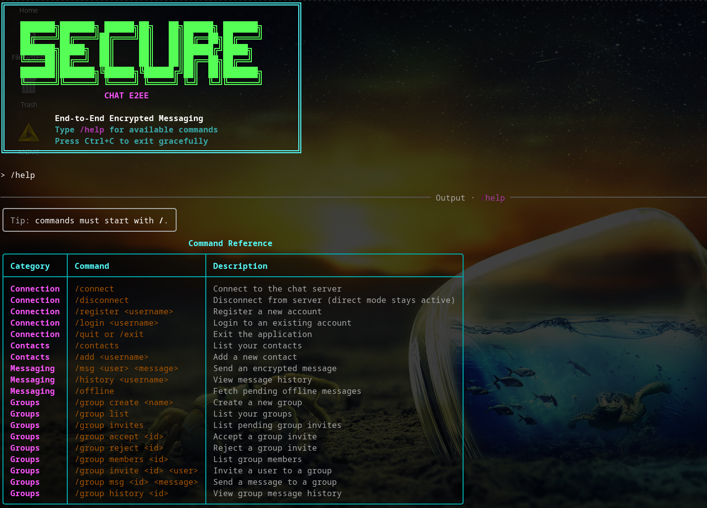

**Figura S2 — Estado da sessão e conectividade no cliente (prompt contextual)**

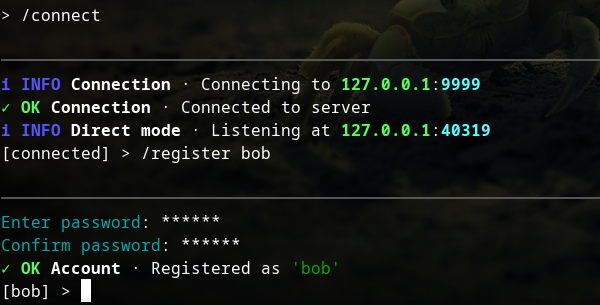

**Figura S3 — Fluxo de fallback direto após `/disconnect`**

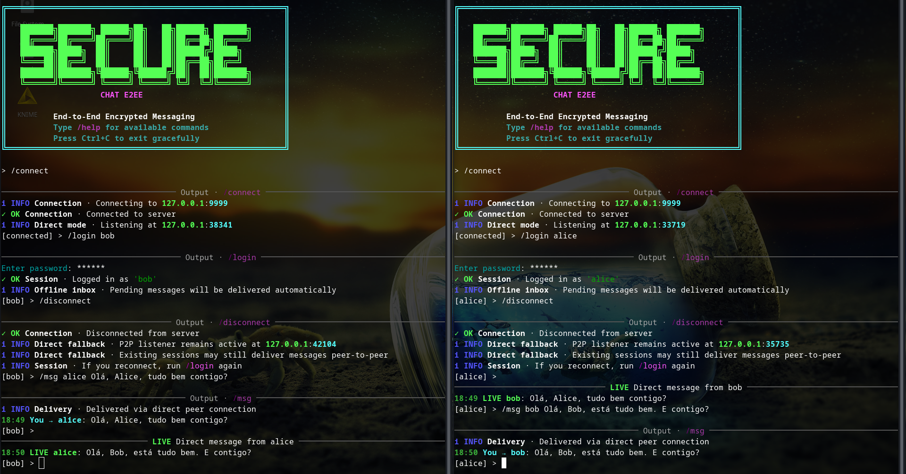

**Figura S4 — Fluxo de grupos (convite, aceitação e troca de mensagens)**

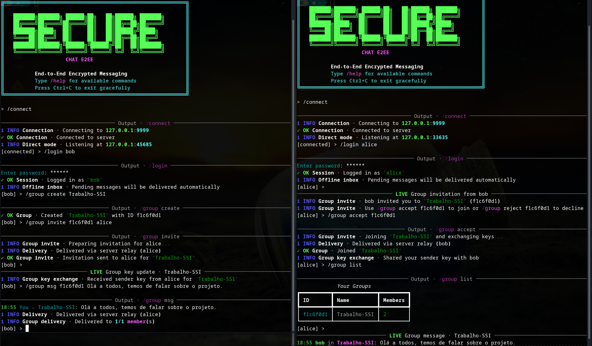

**Figura S5 — Execução dos testes extra da componente de cliente**

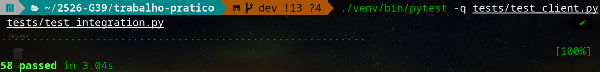

**Figura S6 — Dashboard operacional do servidor**

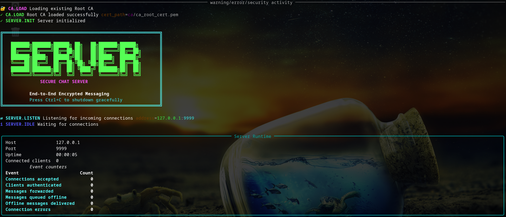

**Figura S7 — Vista de eventos/logs do servidor com separadores visuais**

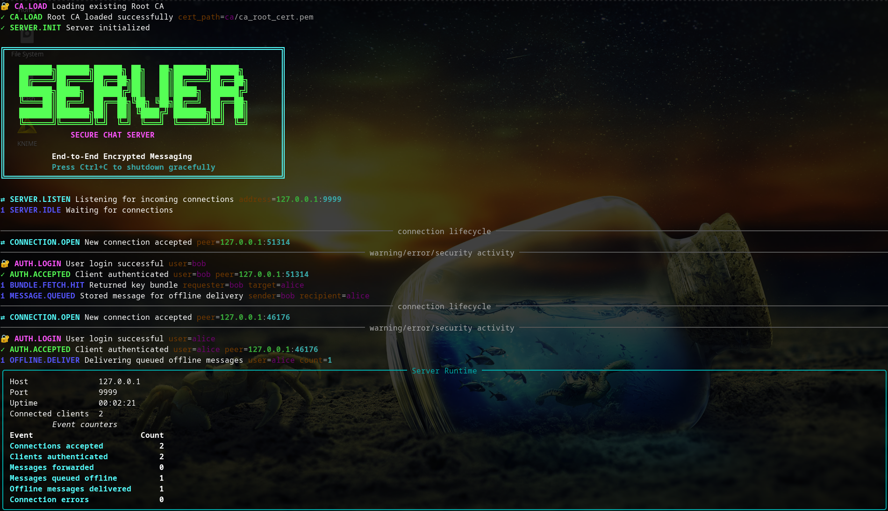

### 1.6 Valorização: Interface Gráfica (GUI)

Como funcionalidade extra, a equipa desenvolveu uma Interface Gráfica de Utilizador (GUI) com recurso à biblioteca Textual. Esta adição melhora significativamente a usabilidade do sistema de chat face à interação tradicional por linha de comandos. A interface apresenta os contactos, os grupos, o histórico de mensagens e o estado de conectividade de forma estruturada e intuitiva. Os utilizadores interagem com o sistema através de painéis visuais e atalhos de teclado, o que torna a experiência mais fluida e acessível.

## 2. Arquitetura funcional do serviço

A solução segue um modelo cliente-servidor com processamento assíncrono de ligações **TCP/IP**. O servidor é implementado em **Python** sobre `asyncio`, com tasks concorrentes por ligação. Cada cliente mantém uma sessão própria e o serviço central conserva apenas o estado mínimo necessário para encaminhamento:

- identidade autenticada da sessão;
- estado online/offline;
- fila de mensagens pendentes quando o destinatário não está disponível.

O estado operacional persiste em **SQLite3**, base de dados local que oferece durabilidade, conformidade transacional (ACID) e simplicidade de deployment sem dependência de servidor externo.

Esta abordagem oferece dois benefícios diretos:

1. **escala funcional** para múltiplas ligações concorrentes;
2. **isolamento de sessões**, com menor risco de interferência entre utilizadores.

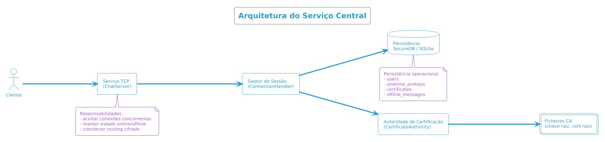

### 2.1 Complemento de segurança E2EE

Adversários considerados:

1. Servidor honest-but-curious
	- O servidor executa encaminhamento e armazenamento, mas pode tentar inspecionar conteúdo.
	- Mitigação: mensagens cifradas E2EE; segredo de sessão e estado de ratchet existem apenas nos clientes.

2. Atacante de rede (MITM)
	- Pode intercetar, alterar, injetar e reordenar tráfego.
	- Mitigação: assinatura de SPK no X3DH, assinaturas Ed25519 em mensagens e autenticação AEAD em transporte/conteúdo.

3. Compromisso de estado/chaves em instante T
	- O atacante obtém estado atual do ratchet de um endpoint.
	- Mitigação: forward secrecy através de evolução irreversível de chain keys e eliminação de message keys antigas.

4. Reordenação de mensagens
	- O atacante atrasa e entrega mensagens fora de ordem.
	- Mitigação: tabela de skipped keys limitada por RATCHET_MAX_SKIP.

### 2.2 Primitivas Criptográficas

<!-- Para cada primitiva, explicar:
- O que é
- Porque foi escolhida
- Como é usada no sistema
-->

| Primitiva | Uso | Justificação |
|-----------|-----|--------------|
| AES-256-GCM | Cifragem autenticada de mensagens | Disponibiliza confidencialidade + integridade num único primitive AEAD, com nonce de 96 bits padrão. |
| Ed25519 | Assinatura de mensagens e SPK | Assinaturas rápidas, determinísticas e robustas para autenticação de identidade. |
| X25519 | Troca de segredo (X3DH e ratchet) | Curva moderna para ECDH com API simples e segura para segredo partilhado de 32 bytes. |
| HKDF-SHA256 | Derivação de chaves de contexto | Permite separação criptográfica entre domínios (X3DH, transporte, root key derivation). |
| PBKDF2-SHA256 | Derivação de password | Aplicada no registo/login com salt por utilizador e custo elevado de iterações, reforçando resistência a brute-force offline. |

### 2.3 Garantias de Segurança

- Confidencialidade
	- Mensagens são cifradas com AES-256-GCM usando message keys derivadas localmente.
	- O servidor recebe apenas ciphertext e metadata mínima.

- Integridade
	- AES-GCM rejeita qualquer modificação de ciphertext/AAD.
	- Mensagens adulteradas falham com erro de autenticação.

- Autenticidade
	- Signed PreKey do destinatário é verificada com Ed25519 antes de X3DH.
	- ChatMessage pode ser assinada e verificada por payload canónico.

- Forward Secrecy
	- Cada mensagem usa message key distinta.
	- Chain keys evoluem por HMAC e não são revertíveis na prática.
	- Mensagens antigas permanecem protegidas mesmo com comprometimento posterior do estado atual.

### 2.4 Arquitetura da cifra no sistema

A arquitetura criptográfica está segmentada por camadas e domínios de chave para evitar reutilização indevida de material:

1. **Camada de transporte (cliente-servidor)**
	- Usa handshake efémero X25519 e HKDF para gerar duas chaves direcionais independentes.
	- Cada frame de transporte é protegido por AES-256-GCM.

2. **Camada de sessão E2EE (cliente-cliente)**
	- Bootstrap de segredo via X3DH (`x3dh.py`).
	- Evolução contínua de chaves por Double Ratchet (`ratchet.py`).

3. **Camada de payload aplicacional**
	- Mensagens (`ChatMessage`) transportam apenas metadados mínimos de sincronização e ciphertext.
	- Assinaturas Ed25519 são aplicadas sobre payload canónico serializado para autenticação de origem.

Esta separação reduz acoplamento entre transporte e conteúdo E2EE e limita o impacto de compromisso local de uma chave isolada.

### 2.5 Derivação de chaves (KDF)

A derivação é implementada em `kdf.py` com **HKDF-SHA256** e **HMAC-SHA256** em três contextos distintos:

1. **HKDF para bootstrap e contextos de domínio**
	- `hkdf_derive(input_key_material, length, salt, info)`.
	- O campo `info` cria separação de domínio (ex.: `X3DH`, `RootKeyDerivation`, transcript do transporte).

2. **KDF de root key no Double Ratchet (`kdf_rk`)**
	- Entrada: `root_key` atual (salt) + novo output DH.
	- Saída de 64 bytes via HKDF: 
		- primeiros 32 bytes: nova `root_key`;
		- últimos 32 bytes: nova chain key inicial.

3. **KDF de chain key por mensagem (`kdf_ck`)**
	- Entrada: `chain_key` atual.
	- Duas derivações HMAC:
		- `HMAC(chain_key, 0x01)` -> `message_key` (uso único);
		- `HMAC(chain_key, 0x02)` -> `next_chain_key`.

Propriedade central: conhecendo uma `message_key` já usada, não se obtém a `chain_key` anterior nem mensagens passadas (one-way evolution).

### 2.6 Funcionamento de `x3dh.py`

O módulo implementa o arranque assíncrono de sessão com validação explícita de autenticidade:

1. **Validação de Signed PreKey (SPK)**
	- `x3dh_sender` verifica `signed_prekey_sig` com a identidade Ed25519 do recetor.
	- Se falhar, a sessão é abortada (`ValueError`).

2. **Cálculo dos segredos DH do iniciador**
	- `DH1 = IK_A_dh × SPK_B`
	- `DH2 = EK_A × IK_B_dh`
	- `DH3 = EK_A × SPK_B`
	- `DH4 = EK_A × OPK_B` (opcional, se existir one-time prekey)

3. **Derivação da session key**
	- Concatenação `DH1 || DH2 || DH3 [|| DH4]`.
	- HKDF com `salt = 0x00..00` e `info = "X3DH"` para produzir 32 bytes.

4. **Espelho no recetor (`x3dh_recipient`)**
	- Reproduz os mesmos DH em ordem compatível para obter chave idêntica.
	- Se `onetime_key_id` for indicado sem chave privada OPK disponível, rejeita o pacote.

Este desenho protege bootstrap de sessão contra MITM de prekeys e cria segredo inicial com contributo efémero.

### 2.7 Funcionamento de `ratchet.py`

O módulo aplica Double Ratchet para confidencialidade futura e recuperação pós-compromisso:

1. **Estado principal (`RatchetState`)**
	- `root_key`, `chain_key_send`, `chain_key_recv`.
	- Par DH de envio atual (`dh_send_priv`, `dh_send_pub`) e DH remoto (`dh_recv_pub`).
	- Contadores `send_count`, `recv_count`, `prev_send_count`.
	- Cache `skipped[(dh_pub, n)] -> message_key` para mensagens fora de ordem.

2. **Envio (`ratchet_encrypt`)**
	- Deriva `(next_chain_key_send, message_key)` por `kdf_ck`.
	- Constrói `MessageHeader(dh_pub, pn, n)`.
	- Cifra com AES-GCM e AAD composta por `aad_externa || header_serializado`.

3. **Receção (`ratchet_decrypt`)**
	- Primeiro tenta chave já guardada em `skipped`.
	- Se `header.dh_pub` mudou, executa `_dh_ratchet_step`:
		- avança root key com novo DH remoto;
		- gera novo par DH local;
		- inicializa nova sending chain.
	- Deriva chaves em falta até `header.n` via `_skip_message_keys`.
	- Deriva `message_key` atual e decifra.

4. **Limite para mensagens fora de ordem**
	- `RATCHET_MAX_SKIP` limita quantas chaves podem ser pré-derivadas e guardadas.
	- Se o salto exceder esse limite, o pacote é rejeitado por segurança e controlo de memória.

### 2.8 Limitações Conhecidas

1. Login depende de material criptográfico local pré-existente no dispositivo (não existe sincronização multi-dispositivo de chaves privadas).

2. O fallback P2P direto exige que ambos os clientes estejam online com listener P2P ativo e endpoint alcançável; em redes restritivas (NAT/firewall), a entrega direta pode falhar e requerer reconexão ao servidor para fila offline.

---

## 3. Protocolo de sessão e transporte

### 3.1 Estabelecimento de canal

O início da sessão usa um handshake de transporte com chaves efémeras. O processo implementa comparação de hashes com proteção contra *timing attacks* através de funções de tempo constante da biblioteca **cryptography**, assegurando que o material criptográfico é independente por ligação. A geração de chaves usa **derivação HKDF** e operações simétricas **AES-256-GCM** para cifra de transporte, separando direções de tráfego (cliente→servidor e servidor→cliente) e reduzindo impacto de compromisso pontual de estado.

### 3.2 Enquadramento de mensagens

Após autenticação, a sessão entra num ciclo de receção e despacho por tipo de mensagem. O servidor interpreta apenas metadados de routing e estado de sessão; o payload de chat permanece no formato cifrado da aplicação.

### 3.3 Política de encaminhamento

Quando uma mensagem chega:

- se o destinatário está ligado, há entrega imediata;
- se o destinatário está desligado, a mensagem entra em fila de entrega posterior.

Este comportamento assegura continuidade de comunicação em redes reais, onde a presença dos utilizadores é intermitente.

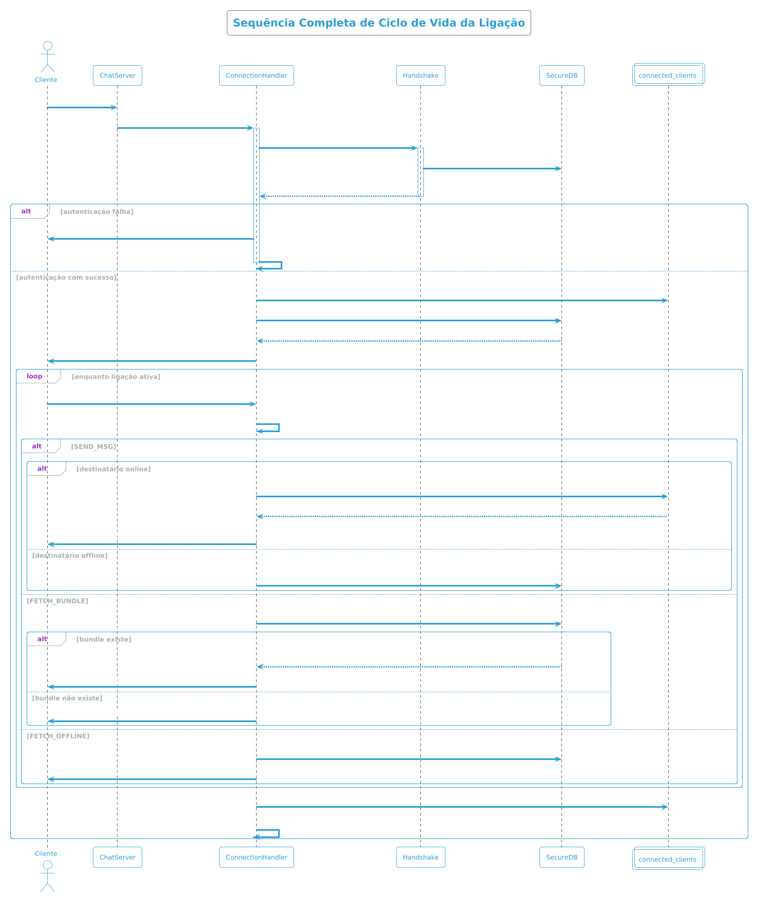

### 3.4 Mensagens de grupo (complemento do cliente)

A camada de grupos foi implementada com `GroupManager` e persistência no `ClientDB`:

1. **Criação de grupo**: o criador gera identificador de grupo e inicializa estado de emissor.
2. **Distribuição de chaves de emissor**: cada membro partilha a sua `sender_key` através de mensagens 1:1 E2EE.
3. **Cifragem de mensagens**: cada envio de grupo deriva `message_key` da cadeia local do emissor, cifra com AES-GCM e incrementa `message_index`.
4. **Decifragem e estado por membro**: recetores mantêm estado por `(grupo, emissor)`, avançam chain key conforme índice recebido e persistem progresso.
5. **Histórico local**: mensagens de grupo decifradas são armazenadas localmente para consulta por `/group history`.

Esta abordagem reduz overhead face a cifragem par-a-par por destinatário e preserva propriedades de forward secrecy ao nível da cadeia de emissão.

Após a remoção de membros (`/group remove`), o sistema executa rotação coordenada de sender keys e redistribuição apenas para membros remanescentes. Esta medida reforça isolamento criptográfico de mensagens futuras face a membros removidos.

### 3.5 Pacotes de mensagens (`messages.py`)

O módulo `messages.py` define envelopes tipados e serialização canónica para transporte/aplicação.

1. **Envelope base (`BaseMessage`)**
	- Campos comuns: `type` (`MsgType`) e `timestamp`.
	- `to_json()` usa JSON compacto com `sort_keys=True` para representação determinística.
	- `from_json()` faz dispatch por tipo para a dataclass concreta.

2. **Pacotes principais do protocolo**
	- `ClientHello` / `ServerHello`: handshake de transporte.
	- `Register` / `ClientAuth` / `AuthOK` / `AuthFail`: autenticação.
	- `FetchBundle` / `BundleResponse` / `BundleNotFound`: diretório de prekeys.
	- `SendMessage` / `DeliverMessage` / `OfflineMessages` / `DirectAck`: entrega online, offline e P2P.

3. **Pacote E2EE (`ChatMessage`)**
	- Metadados X3DH: `x3dh_ik_pub`, `x3dh_ek_pub`, `x3dh_opk_id`.
	- Metadados Ratchet: `ratchet_dh_pub`, `ratchet_pn`, `ratchet_n`.
	- Conteúdo: `nonce`, `ciphertext`, `sig`.
	- `signed_payload_bytes()` exclui `sig` e produz payload canónico para assinar/verificar Ed25519.

Este desenho permite validar integridade/autenticidade sem expor plaintext ao servidor.

### 3.6 Garantia de Forward Secrecy e lógica descentralizada (PGP-like)

Além da rota tradicional via servidor, o cliente suporta entrega direta entre peers com política híbrida:

1. **Server-first**
	- `send_chat_message_routed` tenta primeiro o servidor (store-and-forward quando necessário).

2. **Fallback direto (descentralizado, PGP-like)**
	- Em falha de servidor, o cliente tenta `send_chat_message_direct` para o endpoint P2P anunciado no bundle do contacto.
	- O peer recetor responde com `DirectAck`, confirmando aceitação do payload cifrado.

3. **Porque é “PGP-like”**
	- O servidor deixa de ser requisito para a entrega naquele envio específico.
	- A confiança está nas chaves públicas verificadas e na cifra ponta-a-ponta entre clientes.

4. **Forward Secrecy no modo direto e no modo via servidor**
	- O canal de entrega muda (server vs direto), mas o payload mantém X3DH + Double Ratchet.
	- Assim, a confidencialidade histórica depende do estado de ratchet nos endpoints, não da infraestrutura de encaminhamento.

---

## 4. Protocolo de mensagens offline

O mecanismo offline adota semântica *store-and-forward* com garantia de atomicidade em transações **SQLite**:

1. receção de mensagem cifrada;
2. verificação de disponibilidade do destinatário;
3. registo em fila quando o destinatário está ausente (persistência em BD);
4. entrega automática na próxima autenticação;
5. remoção das entradas já entregues.

A fila segue ordem temporal para preservar sequência de conversação. Esta decisão evita lacunas no histórico apresentado ao destinatário após reconexão.

Do ponto de vista de segurança, o serviço mantém o mesmo princípio operacional: armazena conteúdo cifrado e não executa decifragem da mensagem de utilizador. O uso de transações exclusivas assegura que não existe race condition entre múltiplas sessões na leitura e marcação da fila.

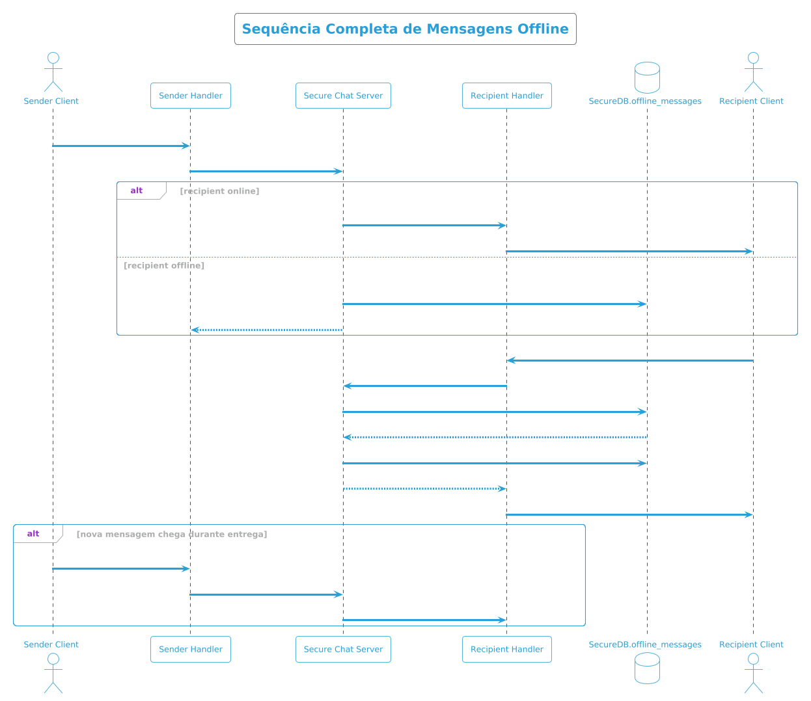

---

## 5. Infraestrutura de confiança (PKI)

### 5.1 Papel da Autoridade de Certificação

A plataforma integra uma CA self-signed para associar identidade lógica (username) à chave pública do utilizador. Esta associação reduz risco de substituição maliciosa de chave no diretório de contactos.

### 5.2 Ciclo de confiança

- na primeira execução, o serviço cria material raiz da CA com **assinatura Ed25519** (par de chaves públicas e privadas);
- nas execuções seguintes, reutiliza esse material (armazenado em ficheiros **PEM** no disco);
- durante registo de utilizador, emite certificado **X.509 assinado** pela CA privada;
- no fornecimento de bundle público, inclui certificado correspondente para validação pelo cliente.

### 5.3 Garantia prática

Com validação correta no cliente, a chave pública recebida deixa de ser “apenas um valor vindo do servidor” e passa a ter vínculo criptográfico com a identidade declarada. Isto reforça a resistência a ataques MITM na fase de bootstrap de sessões entre utilizadores.

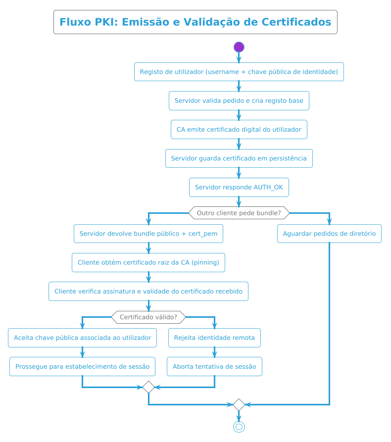

---

## 6. Persistência de estado operacional

A persistência local existe para suportar disponibilidade e consistência do serviço através de base de dados **SQLite3** com esquema relacional:

- dados públicos de identidade necessários ao encaminhamento (tabela `users`);
- material público de arranque de sessão em formato **JSON** estruturado (tabela `onetime_prekeys`);
- certificados emitidos pela CA em formato **PEM** (tabela `certificates`);
- mensagens pendentes para entrega offline com payload E2EE serializado (tabela `offline_messages`).

A implementação privilegia operações explícitas e previsíveis, com transações **BEGIN EXCLUSIVE** nas rotinas críticas (consumo de prekeys e descarga de fila offline). A chave de BD no servidor é resolvida por segredo dedicado (`DB_KEY_HEX` ou `DB_KEY_FILE`) e, no cliente, a chave local é derivada da password com **PBKDF2-SHA256** e salt persistido por utilizador. A autenticação também usa formato PBKDF2 dedicado, sem fallback para formatos legacy. O desenho mantém o backend estável em cenários de reconexão frequente e concorrência de sessões.

> Nota: a componente de storage foi tratada como suporte operacional do serviço; o foco principal deste contributo incidiu nos protocolos de sessão, routing e confiança.

---

## 7. Conclusão

O resultado desta componente estabelece uma base robusta para o sistema E2EE:

- serviço central concorrente e estável;
- gestão clara do ciclo de vida de sessão;
- protocolo offline funcional para utilizadores intermitentes;
- infraestrutura de confiança com CA e certificados;
- separação correta entre coordenação de rede e confidencialidade de conteúdo.

Esta base permite integração consistente com as restantes camadas do projeto, mantendo os requisitos de segurança e de disponibilidade definidos para o sistema.

---

## Team

- João Delgado — 106836  
- Simão Mendes — 106928  
- Hugo Soares — 107293
